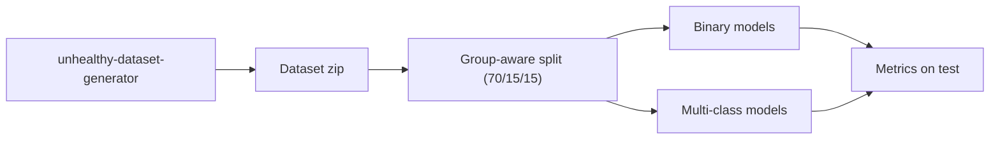

# Junk Food Ads Classifiers

Image classifiers that detect junk food advertising in video frames. Two tasks:

- **Binary**: `junk-food-ad` vs `non-junk-food-ad`.
- **Multi-class**: one ad type per frame.

| Class | Meaning |
| --- | --- |
| `non_ad` | Not an ad |
| `food_brand` | Food brand ad |
| `food_by_nonfood_co` | Food promoted by a non-food company |
| `supermarket_food` | Supermarket promoting food |
| `supermarket_nonfood` | Supermarket not promoting food |
| `restaurant_food` | Restaurant promoting food |
| `restaurant_nonfood` | Restaurant not promoting food |

## Pipeline

Frames from the same ad creative or source video are near-duplicates, so whole groups go to a single split to avoid leakage.

## Notebooks

| Notebook | Task | Approach |
| --- | --- | --- |
| `CLIP-binary-classification.ipynb` | Binary | Zero-shot CLIP, prompt selection on validation |
| `KNN-binary-classification.ipynb` | Binary | KNN over frozen pretrained embeddings |
| `YOLO11-binary-classification.ipynb` | Binary | YOLO 11 classifier |
| `CLIP-multiclass-classification.ipynb` | Multi-class | Zero-shot OpenCLIP ViT-B-16 |
| `KNN-multiclass-classification.ipynb` | Multi-class | KNN over frozen pretrained embeddings |
| `CNN-multiclass-classification.ipynb` | Multi-class | Pretrained backbone + softmax head, optional fine-tuning |

All notebooks are in `src/` and run on Google Colab (GPU), reading the dataset zip from Google Drive.

## Datasets

The datasets are generated with [unhealthy-dataset-generator](https://github.com/merojosa/unhealthy-dataset-generator):

- `binary-dataset.zip`: `ad/`, `non_ad/` and `groups.csv`.
- `tip-multiclass-dataset.zip`: `images/` and `tip_multiclass_dataset.csv`.
